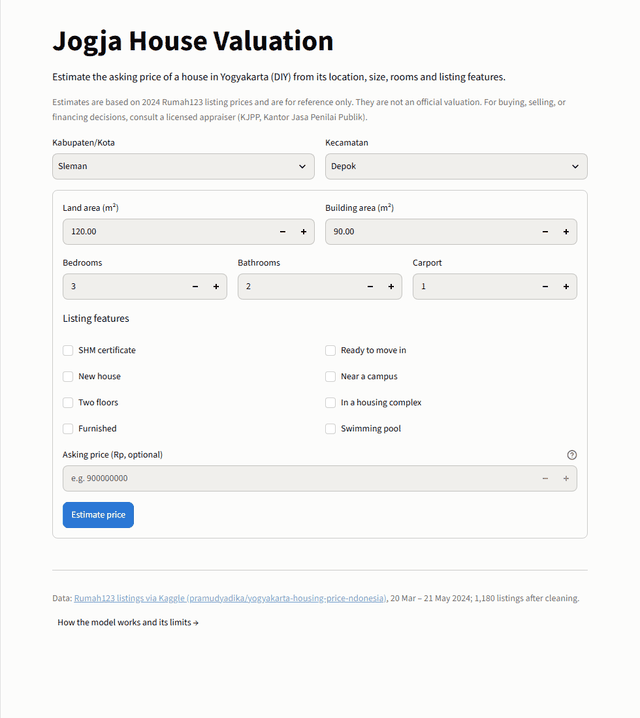
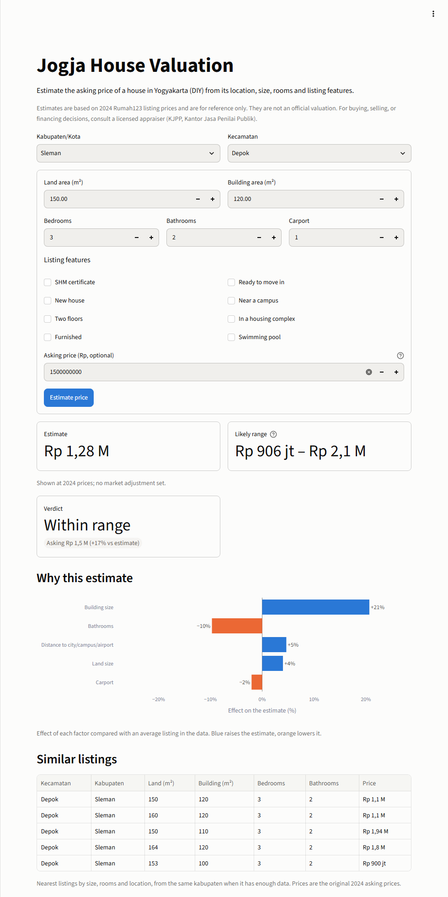
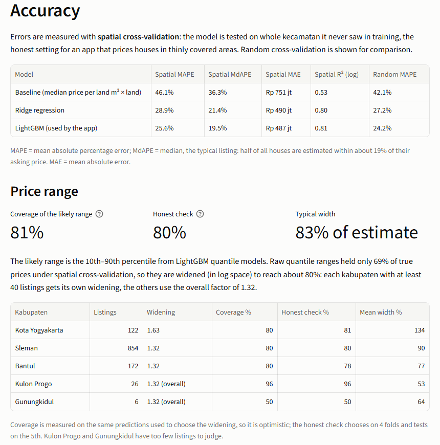
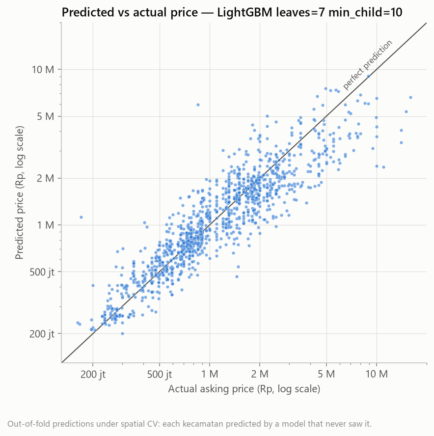
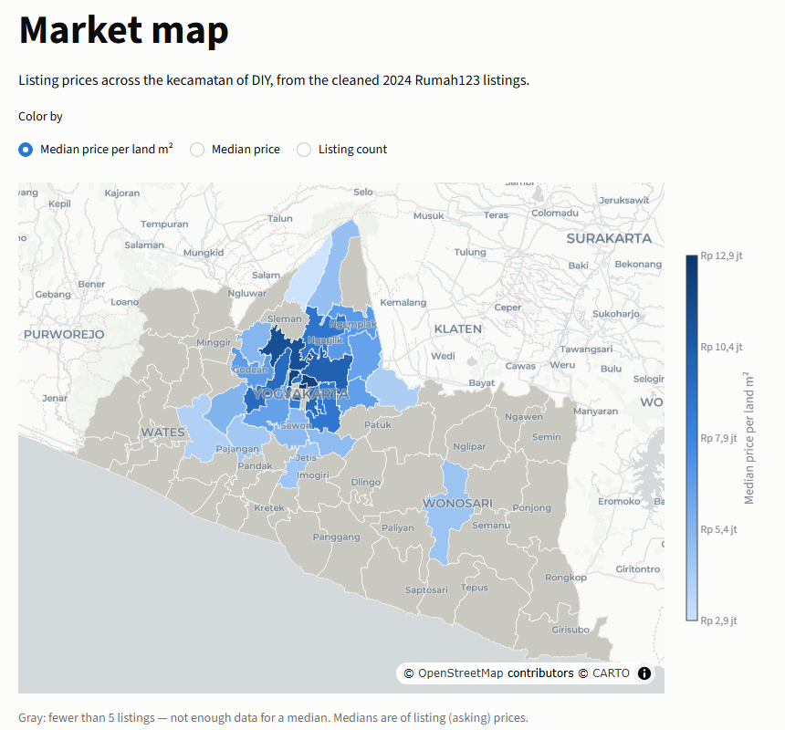
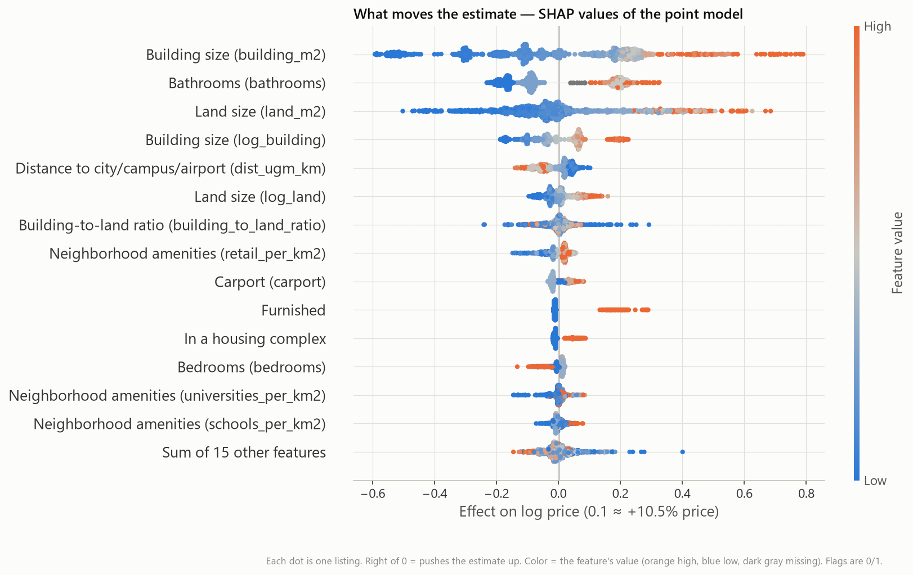

# Jogja House Valuation

Estimate the asking price of a house in Yogyakarta (DIY) with a likely price range, the factors behind the estimate, and five comparable listings, from 1,180 cleaned Rumah123 listings and OpenStreetMap location features.

**Runs locally:** the app is not deployed; start it in two commands ([How to run](#how-to-run-locally)).

**Demo video (1.5 min):** [docs/demo.mp4](docs/demo.mp4) — a full valuation in Ngaglik, Sleman, then the market map and the About page.



What makes it more than a generic house-price model:

- **Messy, real local data:** 2,020 scraped listings → 1,180 after removing reposts, boarding houses, commercial and land listings, and listings with unmatchable locations. Every dropped row has a reason.
- **An honest test:** spatial cross-validation scores the model on whole kecamatan it never saw in training.
- **Ranges, not just a number:** an 80% likely range, calibrated per kabupaten, plus SHAP explanations and comparable listings.
- **A staleness check:** the 2024 model is scored against 30 current 2026 listings.

## The story behind it

Jogja house prices are hard to judge. When I started, the only open data was 2,020 Rumah123 listings scraped in spring 2024. They were asking prices, not sale prices. Many were the same house posted again, some were boarding houses or shops, and locations were free text like "Kaliurang" or "Sleman, Sleman". The goal was a valuation app whose every number I could defend: an estimate, an honest range, the reasons behind it, and real listings to compare against.

**Cleaning without guessing.** A wrong location would quietly corrupt both the features and the test, so I profiled every column before changing anything and wrote one rule per problem, each with a named reason for every row it dropped. Reposts alone were 474 rows, almost a quarter of the file. Area names were mapped to official kecamatan through a file I reviewed by hand, and the 129 listings that could not be placed were dropped rather than guessed. What remained were 1,180 listings I could trust.

**Choosing the harder test.** A random train/test split puts houses from the same neighbourhood, often the same development, on both sides, which flatters the model. The app is used in areas with almost no data, so I tested it that way: spatial cross-validation, where every test fold holds kecamatan the model has never seen, with the same folds for every model. LightGBM reached 25.6% mean error (19.5% for the typical house), against 46.1% for the price-per-m² rule of thumb. The honest test turned out only 1.4 points harsher than a random split (24.2%), partly because removing the reposts had already stopped near-identical houses from sitting on both sides.

**When the ranges fell short.** The price ranges were meant to hold about 8 in 10 true prices; the raw quantile models held 68.7%. I widened them by a calibrated factor, then per kabupaten (Kota Yogyakarta needed 1.63×), and so the fix could not fool me, added a nested check that picks the widening on four folds and tests it on the fifth. Coverage reached 80.6%, and 79.9% in the honest check. Gunungkidul, with only six listings, still sits at 50%, and both the app and this README say so.

**Letting go of my own idea.** I expected road markers like "Jl. Kaliurang km 8" to add street-level detail that kecamatan-level data lacks. I wrote a parser, found the marker in 109 listings (9.2%), and ran the same models and folds with and without it. Spatial error was 25.62% either way. The feature went; the parser stayed for analysis, and the decision is documented instead of becoming an app input that would help fewer than 1 in 10 houses.

**Facing the calendar.** The data is from 2024, but the app is used in 2026. To see how far off the model is today without tuning anything on the answer, I built a hook for a published city-wide price index that is never fitted to data, then collected 30 current listings, ran them through the same cleaning rules and scored them. Error rose to 32.8% with almost no bias on average (median −6%), but the pattern was clear: cheap houses came out 20–37% too high and expensive ones about 30% too low. A single index factor cannot fix errors that pull in opposite directions, and that finding shapes what I would build next.

The result is a three-page Streamlit app backed by 189 tests, with SHAP explanations and comparable listings behind every estimate.

---

## The app

Three pages, built with Streamlit (`streamlit_app.py` and `pages/`):

| Page | What it does |
|---|---|
| **Valuation** | Pick the kabupaten and kecamatan, enter land and building area, rooms, listing features (SHM, new, two floors, pool…) and, optionally, the asking price. Get a valuation in under a second. |
| **Market map** | Choropleth of median price per land m², median price, or listing count for every kecamatan in DIY, with a sortable table. On the price views, kecamatan with fewer than 5 listings are gray. |
| **About the model** | Data and license, the cleaning table, accuracy under spatial CV, range coverage per kabupaten, the 2026 drift check, figures, limitations and the disclaimer. |

### What one valuation returns

| Output | Meaning |
|---|---|
| **Estimate** | The typical asking price for a house like this one |
| **Likely range** | 10th–90th percentile: about 8 in 10 similar houses list inside it |
| **Verdict** | Only with an asking price: *above typical range*, *within range* or *below typical range* |
| **Why this estimate** | The 5 factors that move this estimate most, in % (blue raises it, orange lowers it) |
| **Similar listings** | The 5 nearest real listings by size, rooms and location, same kabupaten first |
| **Warnings** | Inputs outside the training data, or a kecamatan with few listings |



### How a valuation is computed

```
form inputs ─► validate (areas > 0, asking price > 0 if given)
            ─► build_model_features()      same function as in training: sizes, log sizes, ratio, rooms,
                                           flags, kabupaten, OSM features of the chosen kecamatan
            ─► LightGBM point model         estimate = exp(predicted log price)
            ─► LightGBM q10 / q90 models    range, sorted, widened by the kabupaten's calibration factor
            ─► × price index factor         only if one is set (none in this version)
            ─► verdict                      asking price vs the range
            ─► pred_contrib (SHAP)          contributions summed into plain-English factor groups
            ─► k-nearest neighbours         5 similar listings from data/app/comps_pool.csv
```

Everything goes through one function, `src.predict.predict_house()`. The app only reads `models/` and `data/app/`: it never trains and never calls OpenStreetMap. Models load once (`st.cache_resource`) and data files are cached (`st.cache_data`), so a valuation takes under a second after the first load.



## Problem and who it's for

House prices in Jogja are hard to judge. Buyers can't tell whether a listing is fair, sellers don't know what to ask, and agents price mostly by experience. A data-driven estimate with an honest range and an explanation gives all three a reference point.

The primary audience is a recruiter or hiring manager: open the app, value a house, then read the **About the model** page. Buyers, sellers and agents are the illustrative use cases.

## Data

| | |
|---|---|
| Source | [Yogyakarta Housing Price (Indonesia)](https://www.kaggle.com/datasets/pramudyadika/yogyakarta-housing-price-ndonesia), Kaggle, by Pramudya Dika; scraped from rumah123.com |
| Dates | Listings from 20 March to 21 May 2024 |
| License | **CC BY-NC 4.0** (attribution, non-commercial). This is a non-commercial portfolio project. The raw CSV is not committed (`.gitignore`); download it from Kaggle (see below). |
| Prices | Asking prices, not sale prices |
| Location | Kecamatan level only (no street addresses) |
| Location features | OpenStreetMap via osmnx: distances to Tugu, UGM and YIA airport, plus amenity densities per kecamatan |

### Cleaning (2,020 → 1,180 listings, 58%)

| Reason dropped | Rows | % of raw |
|---|---|---|
| Repost of the same house (near-duplicate) | 474 | 23.5% |
| Boarding house (kos) | 147 | 7.3% |
| Location could not be matched to a kecamatan | 129 | 6.4% |
| Commercial, apartment, or land with a small building | 60 | 3.0% |
| Price field is a down payment | 9 | 0.4% |
| Price outside Rp 100 jt – 25 M | 7 | 0.3% |
| Land listing (title starts with "Tanah") | 6 | 0.3% |
| Area or ratio out of range, no building, price per m² out of range | 8 | 0.4% |

Full rules and counts: `reports/cleaning_report.md`. Location mapping (area → official kecamatan, reviewed by hand): `data/external/area_to_kecamatan.csv`.

## Approach

```
Kaggle CSV (2,020 rows, read-only)
  │  src.profile_data   profile raw columns, prices, areas, text
  │  src.clean          parse prices/areas, dedupe reposts, drop kos/commercial/land, every drop has a reason
  │  src.location       area name → official kecamatan (reviewed mapping, --apply)
  │  src.osm_features   OSM kecamatan boundaries → distances + amenity densities + GeoJSON
  │  src.features       build_model_features(): one function shared by training and the app
  │  src.eda            figures 01–06 and five findings
  │  src.train          B0 baseline vs Ridge vs LightGBM, spatial + random 5-fold CV, target log(price)
  │  src.quantile       LightGBM q10/q50/q90, calibrated widening per kabupaten
  │  src.explain        SHAP (LightGBM pred_contrib) grouped into plain-English factors, figure 09
  │  src.comps          k-nearest comparable listings (size, rooms, location)
  │  src.app_assets     bundle app files into data/app/
  ▼
models/ + data/app/  ──►  Streamlit app (Valuation · Market map · About the model)
                              src.predict.predict_house() is the only entry point; the app never trains
Checks: src.ablation_road_km (feature test) · src.drift_check (2026 listings) · pytest (189 tests)
```

- **Target:** `log(price)`. Predictions are converted back with `exp()`, which gives roughly the median price for a house like this one.
- **No leakage:** price per m² and the kecamatan name are never features; location enters only through what OSM says about the kecamatan.
- **Spatial CV:** `GroupKFold` by kecamatan code (two different kecamatan are both called Jetis).

## Results

5-fold cross-validation on 1,180 listings in 43 kecamatan (mean across folds):

| Model | Spatial MAPE | Spatial MdAPE | Spatial MAE | Spatial R² (log) | Random MAPE |
|---|---|---|---|---|---|
| B0 baseline (median price per land m² × land) | 46.1% ± 6.7 | 36.3% | Rp 751 jt | 0.53 | 42.1% |
| Ridge (alpha = 10) | 28.9% ± 2.7 | 21.4% | Rp 490 jt | 0.80 | 27.2% |
| **LightGBM** (7 leaves, min 10 per leaf), used by the app | **25.6% ± 3.2** | **19.5%** | **Rp 487 jt** | **0.81** | **24.2%** |

MAPE is mean absolute percentage error; MdAPE is the median, the typical listing. Half of all houses are estimated within about 19% of their asking price on kecamatan the model never saw.



### Likely range (10th–90th percentile)

| | Coverage | Mean width |
|---|---|---|
| Raw quantile models | 68.7% | 65% of estimate |
| Widened × 1.32 (one factor) | 80.1% | 88% |
| **Per-kabupaten widening (used)** | **80.6%** (honest nested check: 79.9 ± 9.8%) | 91% (median 83%) |

| Kabupaten | Listings | Widening | Coverage | Honest check |
|---|---|---|---|---|
| Sleman | 854 | 1.32 | 80.4% | 79.9% |
| Bantul | 172 | 1.32 | 80.2% | 77.9% |
| Kota Yogyakarta | 122 | **1.63** | 80.3% | 81.1% |
| Kulon Progo | 26 | 1.32 (overall) | 96.2% | 96.2% |
| Gunungkidul | 6 | 1.32 (overall) | 50.0% | 50.0% |

The widening is chosen on the same out-of-fold predictions it is scored on, so "coverage" is optimistic. The honest check chooses on 4 folds and tests on the 5th. Kabupaten with fewer than 40 listings use the overall factor.

## Key findings

1. **The honest test costs little here.** Spatial CV is only 1.4 points worse than random CV (25.6% vs 24.2% MAPE). Removing 474 reposts kept near-identical houses from sitting on both sides of a split, and the OSM features describe a kecamatan rather than identify it.
2. **Size and location beat the rule of thumb.** LightGBM roughly halves the error of "median price per m² × land" (46.1% → 25.6% MAPE).
3. **Location is a big part of price.** Land with its house costs a median Rp 9.8 jt per m² in Kota Yogyakarta, about 2.5× Kulon Progo (Rp 3.9 jt), and prices fall by about 2.6× from within 5 km of Tugu to beyond 15 km.
   
4. **Raw ranges were too confident.** The quantile models covered only 69% of true prices. They needed widening, and the city (Kota Yogyakarta) needed more than elsewhere (× 1.63).
5. **The 2024 model is not biased on average in 2026, but it squeezes the extremes.** On 30 current listings the median error is −6%. Cheap houses (< Rp 1 M) come out 20–37% too high, and houses above Rp 2 M about 30% too low.

Also tested and dropped: a road-kilometer feature parsed from titles ("Jl. Kaliurang km 8"). It was found in only 9.2% of listings and left spatial MAPE unchanged at 25.62% ([ablation](reports/ablation_road_km.md)).



## Staleness and drift

**Time adjustment:** the app can multiply every estimate and range by one city-wide price index factor from published Rumah123 Yogyakarta reports (`PRICE_INDEX_FACTOR` in `src/config.py`). The factor is set by hand and never fitted to data. **No factor was set in this version,** so the app shows 2024 prices and says so; the adjustment code and its tests are in place for when one is.

**Drift check** (`reports/drift_check.md`): 30 current Rumah123 listings, 2026-11-08 (Sleman 12, Kota Yogyakarta 6, Bantul 6, Kulon Progo 3, Gunungkidul 3), validated against the same cleaning rules as training and scored with the model:

| | MAPE | MdAPE | Range coverage | Mean signed error | Median signed error |
|---|---|---|---|---|---|
| 2024 prices (no adjustment set) | 32.8% | 26.5% | 70.0% | −0.2% | −6.2% |

| Asking price | Listings | Median signed error | Range coverage |
|---|---|---|---|
| < Rp 500 jt | 4 | +37% | 25% |
| Rp 500 jt – 1 M | 10 | +20% | 90% |
| Rp 1–2 M | 5 | −6% | 100% |
| Rp 2–5 M | 5 | −31% | 60% |
| > Rp 5 M | 6 | −33% | 50% |

Errors are larger and coverage is lower than in cross-validation (25.6% MAPE, 81% coverage). A single city-wide factor shifts every price the same way, so it cannot fix errors that run in opposite directions at the two ends. The sample is small, especially outside Sleman.

## Limitations

1. **Asking price ≠ sale price.** The model learns what sellers list for; deals usually close lower.
2. **Data is from March–May 2024.** No price index factor was set, so estimates are at 2024 prices; the drift check shows how far off they are today.
3. **About 1,200 listings, located only by kecamatan.** Two houses in the same kecamatan on very different streets look the same to the model.
4. **Thin data outside Sleman.** Sleman holds 72% of listings; Gunungkidul has 6 and Kulon Progo 26, so estimates and ranges there are rough.
5. **Listing text is self-reported** by agents and may be inaccurate.
6. **The most expensive houses are under-predicted** (> Rp 5 M: 44% MAPE in CV). `exp(log prediction)` is closer to a median than a mean, and there are few such listings.

Estimates are for reference only and are not an official valuation. For buying, selling or financing decisions, consult a licensed appraiser (KJPP, Kantor Jasa Penilai Publik).

## How to run locally

Windows PowerShell, Python 3.11, from the repo root.

**App only** (uses the committed `models/` and `data/app/`):

```powershell
py -3.11 -m venv .venv; .venv\Scripts\Activate.ps1; pip install -r requirements.txt
streamlit run streamlit_app.py
```

The app opens at http://localhost:8501.

**Full pipeline** (needs the raw CSV and internet access for OpenStreetMap on the first run):

1. Download the Kaggle dataset and save its CSV as `data/raw/rumah123_yogya_unfiltered.csv`.
2. Install the pipeline dependencies: `pip install -r requirements-dev.txt`.
3. Run the steps in this order. `train` rewrites `metadata.json` and `metrics.md`, so `quantile` must always follow it.

```powershell
python -m src.profile_data; python -m src.clean; python -m src.location --apply; python -m src.osm_features; python -m src.features; python -m src.eda
python -m src.train; python -m src.quantile; python -m src.explain; python -m src.comps; python -m src.app_assets
python -m src.ablation_road_km; python -m src.drift_check
pytest -q
```

## Project structure

```
├── streamlit_app.py            # Valuation page + navigation
├── pages/                      # Market map, About the model
├── src/
│   ├── config.py               # every path, threshold and constant
│   ├── clean.py, location.py, osm_features.py, features.py, eda.py     # data pipeline
│   ├── train.py, evaluate.py, quantile.py, explain.py, comps.py        # models
│   ├── predict.py, app_data.py, app_assets.py                          # app side
│   └── ablation_road_km.py, drift_check.py                             # checks
├── data/
│   ├── raw/                    # Kaggle CSV (not committed; read-only)
│   ├── external/               # kecamatan lists, area mapping, OSM features, drift sample
│   ├── interim/, processed/    # cleaned listings, model table (rebuilt by the pipeline; not committed)
│   └── app/                    # everything the app reads besides models/
├── models/                     # LightGBM point + quantile models, metadata.json
├── reports/                    # cleaning, EDA, metrics, ablation, drift reports + figures/
├── tests/                      # pytest suite
├── docs/                       # README screenshots and demo GIF
└── requirements.txt / requirements-dev.txt      # app only / pipeline + tests
```

## What I'd do next

Left open when the project ended:

- Deploy on Streamlit Community Cloud (pin versions in `requirements.txt` and test a fresh environment first)
- Set `PRICE_INDEX_FACTOR` from published Rumah123 Yogyakarta reports and re-run the drift check to compare before and after

Only if a real user appears:

- Fresh listings on a refresh schedule
- Per-house coordinates via geocoding, instead of kecamatan centroids
- Real **sale** prices from a partner property agency
- Accuracy monitoring over time, building on the drift check
- A seller-lead widget for agency websites ("Cek estimasi harga rumah Anda")

---

Data: Pramudya Dika, *Yogyakarta Housing Price (Indonesia)*, Kaggle, CC BY-NC 4.0. Map tiles © OpenStreetMap contributors, © CARTO.
